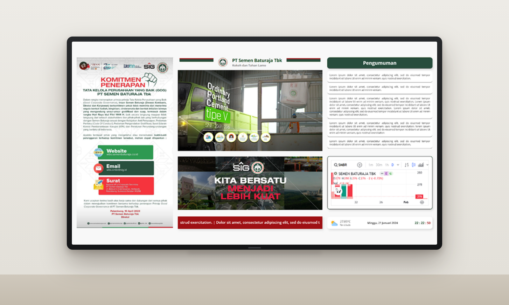
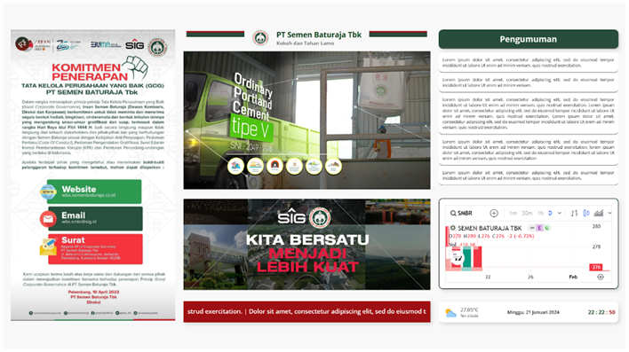

# Papan Informasi Digital PT. Semen Baturaja TBK

Aplikasi web **papan informasi digital (digital signage)** untuk PT Semen Baturaja Tbk. Sistem ini menampilkan berbagai informasi perusahaan secara terpusat dalam satu layar, sehingga tamu dan karyawan dapat melihat informasi terbaru dengan mudah.

## Fitur

- Poster informasi perusahaan
- Slide / video profil dan kegiatan perusahaan
- Daftar pengumuman
- Grafik saham SMBR secara real-time
- Prakiraan cuaca
- Tanggal dan jam
- Teks berjalan (running text)

## Tampilan

## Teknologi

Laravel 10 · PHP 8.1–8.2 · MySQL · HTML, CSS, JavaScript

## Peran

Dikembangkan oleh **Annisa Dwi Septiani** selama magang sebagai **Web Developer** di ICT Solution & Application Department, PT Semen Baturaja Tbk (Desember 2023 – Januari 2024):

- Mengembangkan Sistem Panel Informasi Elektronik berbasis website, dari perancangan antarmuka (UI) hingga back end.
- Berkolaborasi dengan tim dalam penyempurnaan sistem berbasis website.

## Persyaratan
1. Install web server seperti Apache or Nginx
2. Install php 8.1 - 8.2
3. Install MySQL
4. Install composer

## Cara menjalankannya
- Clone repositori
 
      git clone https://github.com/Annisaads/papan-informasi-digital.git

- Pindah ke folder repo

      cd papan-informasi-digital
        
- Install semua dependensi menggunakan composer
        
      composer install

- Salin file env contoh dan lakukan perubahan konfigurasi yang diperlukan di file .env

      cp .env.example .env
        
- Generate key baru

      php artisan key:generate
        
- Jalankan migrasi database (Atur koneksi database di .env sebelum melakukan migrasi)

      php artisan migrate --seed

- Buat symbolic link

      php artisan storage:link
        
- Jalankan server di lokal

      php artisan serve

- Server saat ini berjalan di http://localhost:8000
